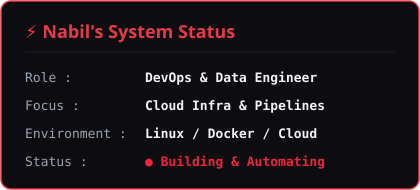
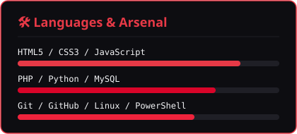

  <!-- Banner GIF Ranpo Edogawa -->
  

    

  <!-- Typing SVG Text -->
  

  
<b>Web Development</b> • <b>Backend & SQL</b> • <b>Aspiring DevOps</b>

  <!-- Profile Views & Badges -->
  

    
    
    
  

### 🛠️ Tech Stack & Daily Tools

  <!-- 12 Icon simetris (6 icon per baris) -->
  

 

### 📊 Profile & Learning Roadmap

  
  

 

  

