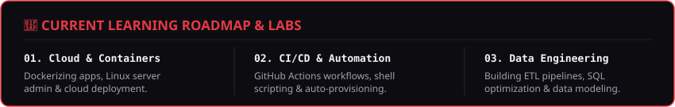

  <!-- Banner GIF -->
  

  

  <!-- Typing SVG -->
  

  
<b>DevOps Explorer</b> • <b>Cloud Infrastructure</b> • <b>Data Engineering</b>

  <!-- Badges -->
  

    
    
    
  

### 🛠️ Tech Stack & Tools

  

 

### 📊 GitHub Analytics & Top Languages

  
  

 

### 📂 Featured Projects

  

