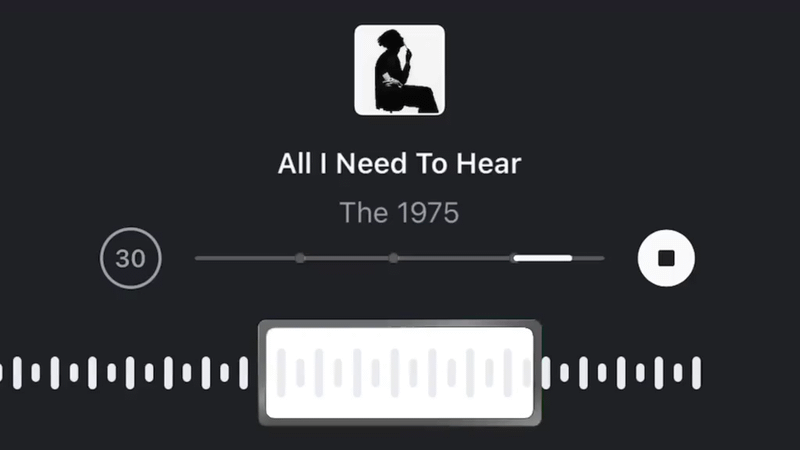

  <!-- Banner Ranpo Edogawa -->
  

    

  <!-- Typing SVG -->
  

  
<b>Web Development</b> • <b>Backend & SQL</b> • <b>Aspiring DevOps</b>

  <!-- Sosmed Badge Pengganti Profile Views di Atas -->
  

    
    
    <a href="mailto:nabilmal.dev">
      
  

### 🌸 About Me

* 🎯 Focused on web development & cloud engineering
* 💻 Building custom educational tools and web apps
* ⚡ Main stack: HTML, CSS, JavaScript, PHP & Python
* 🌱 Exploring DevOps and Cloud infrastructure
* 📌 GitHub: [@nabilm-dev](https://github.com/nabilm-dev)

### 🛠️ Tech Stack

  

 

### 📊 Status & Roadmap

  
  

 

  

 

### 🎧 Listening to

  

